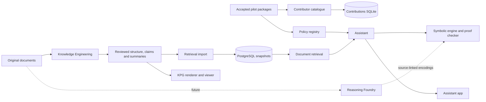

# Knowledge Foundry architecture

**Stage A1 · 27 November 2026 · revision `940d65209827c1032f15d789189cb12cdd5fd5c7`.** The repository has two working paths to an answer. The document pipeline turns source bytes into reviewed evidence and a searchable database projection. The symbolic pilot executes accepted encodings and independently checks their proofs. The Assistant brings the paths together. A future Reasoning Foundry needs its own route from original documents to source-grounded reasoning inputs.

The [file ledger](file-migration-map.md) names every tracked module, script, application asset, configuration, schema, test and fixture, with direct internal dependencies and target paths. The [regression baseline](regression-baseline.md) records what ran. The [migration plan](repository-migration-plan.md) gives the order of changes and compatibility gates.

## Current system

The revision contains 57 package Python files, 25 Python commands and 16 app files across three applications. Its supporting contracts include 15 configuration files, six schemas, 12 prompts, two SQL migrations, 13 originals and their manifest, two example bundles and 76 test/support files. Most reproducibility evidence resides in ignored local artifact trees.



The arrows show data flow and service use. The dotted branch is proposed. Today Docling/Unstructured and their PDF/OCR stack serve document parsing, lxml/cssselect, markdown-it and python-docx handle other formats, and jsonschema validates versioned records. tiktoken and model adapters support generation and retrieval. Haystack, psycopg and pgvector serve document search. Streamlit runs the Assistant, while Contributors uses the Python standard library and SQLite. [Dependency constraints](../requirements.txt)

| Surface | Implemented responsibility and interface | Consumers and dependencies |
| --- | --- | --- |
| Corpus and ingestion | Validate the manifest selection, editions, byte size and SHA-256. `ingest` can verify locally or persist originals. `load_ingested` verifies saved objects against a snapshot. | Parsing reads the pinned snapshot referenced by the run. Corpus readiness also carries source-specific limitations. [Ingestion](../src/knowledge_foundry/ingestion.py) |
| Parsing and document structuring | `parse_collection` dispatches PDF, HTML, DOCX and Markdown through the configured provider. Normalize located elements and preserve provider metadata, layout, tables, figures and hierarchy. `build_collection` chunks the result. `freeze_structure` binds the output bytes. | Internal Docling, local Unstructured and saved provider exports share the `structure(artifact, options)` contract. `config/pipeline.json` also names a Python factory as a string. [Provider boundary](../src/knowledge_foundry/structure_providers.py) |
| Review and semantic preparation | Prepare and finalize parsing and chunk reviews against original sources and layout. Load accepted structure, embed structural chunks and cluster with every-member similarity and request-size limits. | Claims and summaries share a frozen preparation. Request sizing already depends on the claim prompt and candidate schema. Fixture acceptance is scoped to fixture providers. [Review](../src/knowledge_foundry/document_structuring_review.py) · [Preparation](../src/knowledge_foundry/claim_context.py) |
| Generation and classification | Generate grounded candidates, account for primary evidence, preserve qualifying spans and map candidates to curated topics. Persist per-unit progress and reuse validated outputs. Recursive summaries form a separate branch from the same preparation. | Review, graph building and retrieval import consume completed outputs. Provider calls, prompts, budgets, caches and worker count are currently wired into stage modules. [Claims](../src/knowledge_foundry/claim_generation_and_classification.py) · [Summaries](../src/knowledge_foundry/summaries.py) |
| Workflow | A 16-stage graph supervises ingestion through explicit publication. `Workflow` launches scripts and reviewer sessions, records fingerprints, budgets, attempts, history and gates, and controls resume. | Depends on concrete filenames, output layouts, config, reviewer identity and external commands. The graph joins claim review and summaries before indexing. [Controller and stage graph](../src/knowledge_foundry/workflow.py) |
| Reasoning Engine and pilot | A stdlib Python script validates typed facts, rule bodies/heads, incompatibilities and separate queries, computes bounded closure and checks result certificates. `solve` and `check_result` are called directly. A sibling formalizer maps readable inputs and questions separately. | Batch selection/config come from files. The formalizer imports the engine by bare sibling name. The Assistant loads that same engine by verified file path. Historical authoring, setup, replay and review programs also live inside the run trees. [Engine](../scripts/aml_cft_reasoning.py) · [Formalization](../scripts/aml_cft_formalization.py) |
| Accepted packages and Assistant | `DatasetRegistry` validates receipts and source passages, builds policy-only candidates and hosts both frozen replay and fresh execution. `Assistant.ask(question, history)` routes to reasoning, documents, clarification or general answers. `build_case` binds a fresh interpretation to quoted user assertions. | Policy embeddings and a bounded keyword evidence preview feed the router. The document route opens Retrieval and PostgreSQL lazily. Evaluation submits question text and empty history. Contributor catalogues can display references which runtime candidate search must exclude. [Registry](../src/knowledge_foundry/assistant/datasets.py) · [Service](../src/knowledge_foundry/assistant/service.py) |
| Retrieval | `load_artifacts` / `project` translate one completed chunk build and optional classification/summaries into evidence and search records. `DocumentAssistant.retrieve/stream/ask` orchestrates rewriting, Haystack retrieval, ranking, bounded evidence context, answer generation and citation validation. | CLI, workflow, Assistant, Streamlit and evaluation share this path. Passage, claim, summary and passage-and-claim modes resolve results to original evidence. Keyword, vector and combined methods operate within a selected snapshot. [Projection](../src/knowledge_foundry/retrieval/artifacts.py) · [Service](../src/knowledge_foundry/retrieval/service.py) |
| Provenance | Exact evidence identity and spans, structural relationships, candidate/claim links and graph traversal are distributed across package modules and the graph script. `graph_path` selects trusted local HTML by corpus configuration and snapshot identity. | Validators, claim generation, retrieval, graph renderer, citations and UI depend on these joins. Reasoning has another source-index format with versioned passages, locators, clauses and proof references. [Evidence keys](../src/knowledge_foundry/evidence.py) · [Graph binding](../src/knowledge_foundry/retrieval/provenance.py) |
| Storage | `PostgresStore` owns migrations, immutable snapshot import, explicit publication, lexical/vector queries and owner-scoped sessions/messages/feedback. Contributor SQLite code lives in the web app. | Rediscovering a published snapshot, restoring a chat by token and reading contributor history each depend on persisted identity. SQL and application metadata have different lifecycles from derived vectors. [PostgreSQL](../src/knowledge_foundry/storage/postgres.py) · [Contributor storage](../apps/contributors/app.py) |
| Shared services | Bounded parallelism, model transport, token counts, embedding validation and atomic cache writes serve multiple components. JSON identity hashing currently lives with structural links. | Embeddings, Storage and Assistant import normalization or hashing via engineering modules. Transport is split across structured calls, streaming and local endpoints. [Concurrency](../src/knowledge_foundry/concurrency.py) · [Embeddings](../src/knowledge_foundry/embeddings.py) · [Structural links](../src/knowledge_foundry/structural_links.py) |

### Entrypoints and startup

The checkout uses a `src/` layout and a single [requirements file](../requirements.txt). It has no tracked packaging manifest, installed console-script definitions or CI workflow. Scripts arrange import paths themselves. Their file names, arguments, aliases, exit statuses, stdout and output-directory rules are public interfaces. The [command ledger](file-migration-map.md#commands) covers all 25. The frozen formalizer relies on direct script execution to find its engine sibling. Existing module execution also matters for `knowledge_foundry.ingestion`, `knowledge_foundry.parsing` and `knowledge_foundry.document_structuring_review`.

| Application | Start and external interface | Runtime assumptions |
| --- | --- | --- |
| Assistant | `.venv/bin/python -m streamlit run apps/assistant/app.py --server.port 8502`. Automatic and direct document search share this launcher. | Automatic uses accepted packages and session-local chat state. Direct search has its own token, PostgreSQL history/feedback, corpus/snapshot selection and graph viewer. Preserve `chat_token`, stylesheet lookup, sibling imports and the behavior when document service is unavailable. [Assistant guide](aml-cft-reasoning-assistant.md) |
| Contributors | `.venv/bin/python apps/contributors/app.py` serves loopback port 8503. Its CLI also provisions accounts. GET serves the UI, session, catalogue, cases, contributions, history and downloads. POST handles login/logout, sources, reviews, typologies and state transitions. | Bare `accounts` and `catalog` imports, sibling assets, accepted package receipts, optional HTTPS public origin, authenticated actor and local SQLite path. A submission records a proposal or a file. It does not launch ingestion. [Startup and storage guide](../apps/contributors/README.md) |
| KPG Viewer | `scripts/render_knowledge_graph.py --bundle … --output …` produces a standalone HTML file opened directly or embedded by the Assistant. | The HTML template, CSS and four ordered scripts receive `window.graphData` with nodes and edges. Preserve template substitution, script escaping, relation names and native record IDs. The template alone requires the renderer. [Renderer](../scripts/render_knowledge_graph.py) · [Viewer assets](../apps/kpg_viewer/) |

### Durable contracts

| Producer → consumer | Files or identity that must survive the move |
| --- | --- |
| Source inventory → both document consumers | `data/manifest.json` names 13 originals with manifest ID, source ID/version, local path, publisher, media type, size and digest. The engineering store writes `artifacts/ingested/objects/`, immutable `snapshots/<digest>.json` and a mutable `report.json` pointer. A dated run's `run.json` identifies its snapshot relative to the run. [Pipeline guide](aml-cft-pipeline.md) |
| Parsing → chunking → acceptance | Per-document `artifact-bundle.json`, `parse.json`, native provider responses and figure assets feed the chunk bundle, hierarchy, structural chunks/links and metadata. `structuring-manifest.json` pins outputs, native data, assets and the snapshot. Review samples, judgments, reports and `acceptance.json` bind the two review gates to that snapshot. Re-freezing invalidates prior acceptance. [Freeze and validate](../src/knowledge_foundry/document_structuring.py) |
| Preparation → independent generation branches | `semantic-clustering/build-manifest.json` binds bundle SHA, cluster plan, prompt/schema and outputs including embeddings and memberships. Claims persist `claim-candidates.jsonl`, cluster mappings, evidence accounting, build manifest and retry checkpoints. Classification emits the canonical bundle, claims, topics and report. Summaries persist `summaries.jsonl`, summary clusters/embeddings, model schema, prompt and preparation binding. Keep complete/partial states, lineage and selection on retry. [Downstream uses](downstream-uses.md) |
| Bundle → search, graphs, evidence | Source identity is the ID/version pair. Document ID hashes source ID and content digest. Element ID hashes document ID and locator key, with a separate revision over kind and text. Chunk ID includes document ID, chunker version, ordered canonical evidence and text. Candidate/claim IDs include the relevant build, evidence and text. Topic ID comes from the taxonomy and its revision binds title, summary and sorted claim IDs. Build IDs bind version/config/inputs. [Cross-record checks](../scripts/validate_artifact_examples.py) |
| Derived objects → retrieval/DB | Preserve `structural:`, `semantic:`, `summary:`, `ev:` and `snapshot:` identities and their distinct inputs. Evidence joins source, document, element, revision and optional exact span. A heading added as context has different citation semantics from a primary passage. Import binds records, evidence, corpus, language and embedding profile to the snapshot. Publication changes the corpus pointer after completeness checks. [Projection](../src/knowledge_foundry/retrieval/artifacts.py) · [Storage](../src/knowledge_foundry/storage/postgres.py) |
| Reasoning packages → runtime, contributors and replay | Registry entries bind acceptance/status files by path and SHA-256. Readers support synthetic `exact_sha256`, BO named `accepted_artifacts` and KYC nested setup/role aliases. Keep dataset/version, batch, family, case, FR/EN, scope/date, separate encoding and query, clause/passage IDs, results, certificates and checks. BO and KYC use repaired artifacts from specific rechecks. [Registry paths](../config/aml-cft-reasoning-datasets.json) · [Accepted selections](aml-cft-reasoning-pilot.md) |
| Workflow and evaluations → resume and historical audit | Workflow `state.json`, attempt directories, fingerprints, history and reports bind code, settings and evidence. Retrieval checkpoints bind per-case rows to the snapshot/config. Assistant evaluation separates authoring, questions, provisional references, live submissions, reviews and scores. The approved source list, reviewed run and current offline preparation have distinct identities. [Evaluation history](aml-cft-reasoning-assistant-evaluation.md) |

Six JSON schema files describe the bundle, candidate, compilation output, semantic preparation, summaries and symbolic representation. Runtime validation also uses Python-defined model response schemas, preserved prompt text, format versions, hash checks and cross-record validation. Conformance to a JSON shape alone cannot establish evidence coverage, acceptance or proof validity. The [schema ledger](file-migration-map.md#schema-contracts) and [configuration ledger](file-migration-map.md#configuration) identify the owners.

## Coupling found in the checkout

The following four strongly connected groups appear in the static import graph across production Python, including imports inside functions. Lazy imports allow these paths to run today. Moving files without changing dependency direction would carry the cycles into the monorepo.

| Cycle or misplaced responsibility | Why the move matters | Proposed cut |
| --- | --- | --- |
| `parsing ↔ structure_providers ↔ provider_exports` | Parsing resolves providers. The internal provider imports private parser configuration/metadata from parsing. Export conversion imports the result type back from the provider module. | Put the provider result/protocol and normalization inputs below orchestration. Keep factory names and return types available to external providers. |
| `chunking ↔ document_structuring` | Chunk assembly freezes its output. Structural auditing imports chunk text cleanup and a private location key. | Extract the text/location helpers into a leaf and preserve the single freeze operation at the stage boundary. |
| `claim_context ↔ claim_generation_and_classification ↔ classification_reuse ↔ scripts.deterministic_claim_review` | Preparation needs the exact generation request to size clusters. Classification reuse calls a review script's private loader. Review also imports private generation helpers. | Give request construction/schema and saved-classification validation one owner each. Call them from both sides and keep both generation branches' inputs byte-compatible. |
| Evaluation generator ↔ evaluation validator | Generation calls final validation. Validation imports generation constants, helpers and reproduction logic. Both files are pinned. | Preserve v1 bytes. For a successor, share deterministic construction and file definitions below separate preparation and validation drivers. |

Three further boundaries affect more than imports.

- **Runtime code relies on checkout tooling.** Chunking, review, claims and retrieval import `scripts.validate_artifact_examples.check`. That script loads the schema and corpus manifest at import time. Move reusable bundle validation below the consumers and leave manifest/example verification in the command. The graph script likewise combines lineage assembly with application HTML rendering.
- **Independent consumers currently inherit engineering dependencies.** Storage imports `stable_hash` from `structural_chunks`, which imports it from `structural_links`. Assistant search imports vector normalization from `semantic_clusters`. Serving a query imports `retrieval.artifacts`, bringing preparation and summary readers into the serving path. Isolate shared primitives and the engineering import adapter. Preserve each serialization and cache identity. Similar function names such as `digest` currently accept different inputs.
- **Business rules sit in transport and data access.** Assistant registry loading also projects BO/KYC policy exceptions, normalizes KYC entities and chooses candidate policies. The contributor HTTP handler validates submissions, enforces ownership and executes storage operations. Its catalogue imports Assistant internals for receipt validation. Split shared receipt verification from policy projection and keep authentication, domain authorization, SQLite transactions and HTTP response mapping explicit. [Assistant dataset implementation](../src/knowledge_foundry/assistant/datasets.py) · [Contributor HTTP and storage](../apps/contributors/app.py)

## Proposed package boundaries

Keep one Python namespace and the existing repository commands and data roots. The following is a target for later stages. The detailed ledger assigns implementation files and identifies frozen compatibility paths.

```text
src/knowledge_foundry/
  knowledge_engineering/       ingestion, corpus, structuring/, review/, semantic/, claims/, summaries/
  reasoning_engine/            symbolic execution, validation and certificate checking
  reasoning_foundry/           future raw-document authoring and source grounding
  retrieval/                   query, ranking, answering, evaluation, adapters/engineering.py
  provenance/                  source and evidence identities, bundle validation, receipts, graph data
  storage/                     PostgreSQL, SQL migrations, SQLite accounts and contributions
  assistant/                   routing, interpretation, policy projection, case construction, wording
  shared/                      paths, hashing, vectors, embeddings, token counts, model transport, concurrency
  applications/                assistant/, contributors/, kpg_viewer/ presentation and startup wiring
  workflows/                   document pipeline, reasoning_pilot/, assistant_evaluation/
```

Shared services depend on technical libraries. Provenance exposes source/locator and receipt primitives that can be used without importing a pipeline or opening a store. Knowledge Engineering produces document artifacts. Storage owns physical persistence. Retrieval consumes a read-store interface, with a separate adapter for importing engineering bundles. The Assistant consumes accepted policy projections, a checked engine and document retrieval. Applications and workflows compose these dependencies. Intermediate package moves must preserve the current launchers and pinned loaders.

**Reasoning Foundry starts at original bytes.** Its input is a local document or byte stream plus source identity, edition/media type and content digest. It locates passages in the original, records reproducible locators and excerpts, proposes clauses/rules with passage links and emits versioned reasoning inputs for the Engine and subsequent review. It can share byte verification and source-locator types. The entrypoint must run in a workspace containing raw documents and its own configuration with the engineering run trees, accepted chunks, claims, summaries, graph, search index and PostgreSQL all absent. Historical BO/KYC authoring from selected claims remains a separate pilot workflow. The [future capability gate](repository-migration-plan.md#8-reasoning-foundry-independence) makes this boundary testable.
