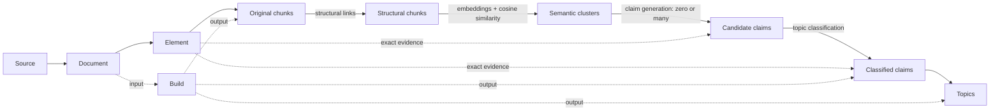

# Knowledge Foundry artifact schemas

The [bundle schema](../schemas/artifact-schema-v1.0.0.json) defines seven normalized
record types; the [candidate claim schema](../schemas/claim-candidate-artifact-schema-v1.0.0.json)
defines intermediate candidate claims. `properties`/`required` define fields,
`$defs`/`$ref` reuse definitions, `oneOf` selects a location format, and
`additionalProperties: false` rejects unknown fields.

Bundles and records use `schema_version: "1.0.0"` for field layout, independent of
publisher versions. A bundle contains seven arrays: `sources`, `documents`,
`elements`, `chunks`, `claims`, `topics`, `builds`; nested definitions cover
locations, evidence, generation and spans. Bundles may span saved files; the
schema does not require one JSON file per PDF. Claim generation and classification
define the export layout.

## Records

| Record | Contents and main links |
| --- | --- |
| Source | Publisher item, URL, format and edition/legal revision; stable `id` plus `version`. |
| Document | Saved file, SHA-256, media type, capture date `retrieved_on`; links `source_id`/`source_version`. |
| Element | Parsed heading, paragraph, table or other unit with text/native location; links `document_id`/`locator_key`. |
| Chunk | Retrieval text assembled from elements; links `document_id`, `build_id`, `evidence`. |
| Claim | Atomic assertion with exact evidence, generation metadata and separate grounding/classification statuses; links `topic_id`, `build_id`, `chunk_ids`, `evidence`. |
| Topic | Related claims under a stable ID, summary and content revision; links `claim_ids`, `build_id`, `revision`. Tags are optional filters. |
| Build | Logical build's inputs, settings, outputs and status; links input document IDs and output chunk/claim/topic IDs. |

Candidate claims are JSONL records, not an eighth bundle array. They preserve
text, chunks, exact evidence, generation metadata and generation-build ID.
Classification consumes them without regenerating statements.

`retrieved_on` is a capture date, not publication or legal effectiveness. The
[source manifest](../data/manifest.json) records the configured collection’s saved files.

## Stable IDs

Source IDs are readable names such as `src:maintenance-guide`, distinct
from manifest label `GUIDE`; retain them across URL/edition changes. Topic IDs such as
`topic:equipment-maintenance` are curated and stable across builds.

`H(text)` is lowercase hexadecimal SHA-256 of UTF-8 text; `\n` is one newline.
`content_sha256` hashes saved bytes, matches the examples' manifest `sha256`, and
contributes to the document ID:

```text
document.id = "doc:" + H(source_id + "\n" + content_sha256)
element.id  = "el:" + H(document_id + "\n" + locator_key)
chunk.id    = "chunk:" + H(document_id + "\n" + chunker_version + "\n" + canonical_evidence + "\n" + text)
build.id    = "build:" + H(pipeline_version + "\n" + config_sha256 + "\n" + "\n".join(sorted(input_document_ids)))
claim.id    = "claim:" + H(build_id + "\n" + canonical_evidence + "\n" + text)
candidate.id = "candidate:" + H(generation_build_id + "\n" + canonical_evidence + "\n" + text)
topic.revision = H(title + "\n" + summary + "\n" + "\n".join(sorted(claim_ids)))
```

`canonical_evidence` is compact JSON with sorted keys, unescaped Unicode and
preserved array order: `json.dumps(evidence, ensure_ascii=False, sort_keys=True,
separators=(",", ":"))`. The schema does not prescribe serialization for the
supplied `config_sha256`. Build IDs sort input document IDs and exclude outputs.

Element revision is `H(kind + "\n" + text)`: changed text at the same document/
locator changes revision, not element ID. Evidence must cite that revision.
Changed saved bytes change document/dependent IDs. Claim IDs exclude `topic_id`,
so reassignment within a classification build preserves identity; revised
taxonomy creates a new build. Output-changing code requires a new
`pipeline_version`. The [validator](../scripts/validate_artifact_examples.py)
checks IDs and links.

## How the records connect

IDs must resolve to existing records. Source editions require **both** ID and
version; builds may span documents.



The [pipeline and record-lineage diagram](images/artifact-record-links-v1.0.0.svg)
shows canonical bundle records and the separate structural chunks, semantic
clusters and candidate claim artifacts. Unclassified candidate claims remain
available. Derived memberships preserve original chunk IDs and exact evidence;
they do not add record types to the v1.0.0 bundle.

| Link | Required relationship |
| --- | --- |
| Document → source | `source_id`/`source_version` match source `id`/`version`. |
| Element → document | `document_id` names the file containing its native location. |
| Chunk → document/build | `document_id` names its saved file; `build_id` names its producing build. |
| Chunk → evidence | `element_id`/`element_revision` match element `id`/`revision`; evidence `document_id` equals the chunk's and element's, and `source_id` equals the document's. |
| Build → inputs | `input_document_ids` includes every document used by its chunks. |
| Build → outputs | `output_chunk_ids`, `output_claim_ids`, `output_topic_ids` contain all records whose `build_id` names that build. |
| Claim → chunks | `chunk_ids` names supporting chunks whose documents are inputs to the claim classification build; each claim passage occurs in those chunks. |
| Claim → evidence | Exact element ID/revision, document ID and source ID, resolved as for chunks. |
| Claim ↔ topic | `topic_id` is the authoritative single assignment; `topic.claim_ids` is its exact inverse within the same build. |

Manifest labels map to stable source IDs. The validator matches entries by
URL/hash, then checks version and capture date. Builds name inputs/outputs;
evidence resolves to the element revision and its native location.

## Locations and supporting passages

| Format | Native location |
| --- | --- |
| PDF | One-based file page, printed label and optional PDF-point box (`left, top, right, bottom`). Without a label, use a consistent within-page block index. Splitting/merging blocks may change element IDs. |
| HTML | Article ID, selector and optional clause/anchor. |
| Markdown | Heading path and one-based line range. |
| DOCX | Zero-based block index; table, row and cell indices where relevant. |

Evidence names `source_id`, `document_id`, `element_id`, matching
`element_revision`, and optional Unicode code-point span `[start, end)` where
`0 <= start < end <= len(text)`. Multiple passages need multiple references.
Locations/versions make evidence reviewable; preserve native locators after parsing.

Claims may use multiple documents and an upstream chunk build. Their classification
build must include all supporting documents, and each evidence reference must
exactly match a span-bearing passage in a supporting chunk.

Claim `grounding_review_status` and `classification_review_status` independently
use `draft`, `verified` or `rejected`; verified support can coexist with draft or
rejected classification. Topic `review_status` concerns its summary.
`claim.generation` and `claim.classification` separately record `manual`/`model`
and version; model records also require model ID/prompt hash.

Examples are drafts, not expert reviewed. Current topic exports contain a draft
notice rather than substantive synthesis; inspect claims/passages before use.
Do not infer effective dates, exceptions or conflict resolutions from capture dates.

## Examples and validation

The [PDF example](../examples/artifact-bundle-pdf.json) and
[HTML example](../examples/artifact-bundle-html.json) are corpus-specific fixtures
with illustrative passages, chunks, draft claims and topics. Both hash saved bytes
and illustrate the contract, not parser output or approved answer labels.

With `jsonschema` installed, run `python3 scripts/validate_artifact_examples.py`
to check saved sources, schemas, IDs, references and spans. This does not measure
parsing or retrieval quality.

## Frozen structural chunks and semantic clusters

[Structural chunks and semantic clusters build manifest](../schemas/claim-context-artifact-schema-v1.json) is separate
from the canonical chunk, candidate claim and claim schemas. It pins the original bundle,
configuration, prompt/schema assumptions and exact semantic cluster plan.

| File | Purpose |
| --- | --- |
| `structural-chunks.jsonl` | Derived text, original chunk membership and evidence memberships |
| `structural-links.jsonl` | Identity/heuristic link reasons and original endpoints |
| `embeddings.jsonl` | Vectors, exact input hashes and cache/provider provenance |
| `semantic-clusters.json` | Unique memberships, request hashes/counts and minimum similarity |
| `report.json` | Sizes, refinement diagnostics and structural chunk and semantic cluster build telemetry |
| `build-manifest.json` | File hashes, versions and frozen assumptions |

Link reasons cover shared fragments, governing context, numbered/bulleted list
introductions, adjacent sentence/table continuations and same-page note markers.
The schema enumerates the accepted reasons; heuristic links require source review.

Generation copies the frozen build and saves the candidate-claim-to-cluster mapping
in `candidate-clusters.json`, preserving canonical evidence and original chunk IDs. Evidence
spans use zero-based character offsets: start inclusive, end exclusive. See
[claim generation and classification](claim-generation-and-classification.md) for cache keys, compatibility and resume rules.
