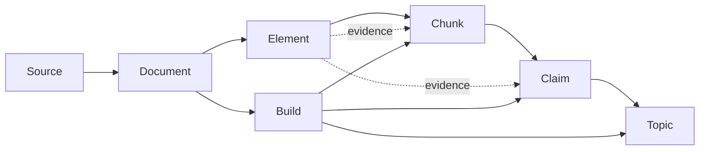

# Knowledge Foundry artifact schemas

The [JSON Schema](../schemas/artifact-schema-v1.0.0.json) defines seven normalized bundle record types. The separate [candidate artifact schema](../schemas/claim-candidate-artifact-schema-v1.0.0.json) defines durable intermediate claim candidates. `properties` and `required` specify fields, `$defs` and `$ref` reuse definitions, `oneOf` selects a location format, and `additionalProperties: false` rejects unknown fields.

The bundle contains `schema_version` and seven arrays: `sources`, `documents`, `elements`, `chunks`, `claims`, `topics`, and `builds`. Nested definitions cover locations, evidence, generation, and spans.

A **bundle** validates records from one or more saved files; it does not prescribe one JSON file per PDF. The [PDF example](../examples/artifact-bundle-pdf.json) samples one paragraph, chunk, draft claim, and draft topic from a 70-page file. Compilation defines the export layout.

The bundle and every record use `schema_version: "1.0.0"` for field layout, distinct from the publisher's document version.

## Records

| Record | What it stores | Main links |
| --- | --- | --- |
| Source | A publisher item, its URL, format, and edition or legal revision. | Stable `id` and publisher `version`. |
| Document | One saved file, its SHA-256 hash, media type, and `retrieved_on` date. | `source_id` and `source_version`. |
| Element | One parsed heading, paragraph, table, or other unit, with text and a location in the file. | `document_id` and `locator_key`. |
| Chunk | Text assembled for retrieval, with references to the elements it uses. | `document_id`, `build_id`, and `evidence`. |
| Claim | An atomic assertion supported by chunks and exact source passages, with separate grounding and classification review statuses and generation metadata. | `topic_id`, `build_id`, `chunk_ids`, and `evidence`. |
| Topic | A stable knowledge unit that groups related supported claims around coherent subject matter. It has a summary and revision. | `claim_ids`, `build_id`, and `revision`. |
| Build | The inputs, settings, outputs, and status of a logical build. | Input document IDs and output chunk, claim, and topic IDs. |

Candidate claims are intermediate JSONL records, not an eighth normalized bundle
array. They retain candidate text, supporting chunks and exact evidence,
generation metadata, and a generation-build ID. Classification consumes them
to create normalized claims and topics without making generation calls again.

`retrieved_on` is when the local file was captured, not when the text was published or legally effective. The [source manifest](../data/manifest.json) lists the pilot's saved files.

A **topic** groups claims under a stable ID and content revision. Tags are optional filters. Evidence-linked draft claims still need review.

## Stable IDs

A **source ID** is a stable, readable name such as `src:acpr-tracfin-joint-guidelines`, stored in the manifest and distinct from label `A`. Keep it across URL and edition changes; `version` identifies the edition.

Topic IDs are curated names such as `topic:beneficial-ownership`, stable across builds. Other IDs use the formulas below. `H(text)` is lowercase hexadecimal SHA-256 of UTF-8 text; `\n` is one newline. `content_sha256` hashes saved file bytes and matches the manifest's `sha256` in both examples. It is an input to the document ID, not the ID itself.

```text
document.id = "doc:" + H(source_id + "\n" + content_sha256)
element.id  = "el:" + H(document_id + "\n" + locator_key)
chunk.id    = "chunk:" + H(document_id + "\n" + chunker_version + "\n" + canonical_evidence + "\n" + text)
build.id    = "build:" + H(pipeline_version + "\n" + config_sha256 + "\n" + "\n".join(sorted(input_document_ids)))
claim.id    = "claim:" + H(build_id + "\n" + canonical_evidence + "\n" + text)
candidate.id = "candidate:" + H(generation_build_id + "\n" + canonical_evidence + "\n" + text)
topic.revision = H(title + "\n" + summary + "\n" + "\n".join(sorted(claim_ids)))
```

`canonical_evidence` serializes an evidence array as compact JSON with sorted object keys, unescaped Unicode, and preserved array order (`json.dumps(evidence, ensure_ascii=False, sort_keys=True, separators=(",", ":"))`). `config_sha256` is a supplied settings digest; the schema does not define settings serialization. Build IDs sort input document IDs and exclude output IDs.

An element's `revision` is `H(kind + "\n" + text)`. For the same document and locator, changed text changes the revision but not the element ID; evidence must cite the revision. Changed saved bytes change document and dependent IDs. Claim IDs exclude `topic_id`, so reassignment does not affect identity within a classification build; a revised taxonomy creates a new classification build. Output-changing code needs a new `pipeline_version`. The [validator](../scripts/validate_artifact_examples.py) checks these rules and record links.

## How the records connect

Each link ID must name an existing record. A source edition requires **both** `id` and `version`; builds may span documents.



The [record ID image](images/artifact-record-links-v1.0.0.svg) shows the complete v1.0.0 path and the build and evidence links. It is a diagram of the record contract, not an implemented parser or classifier.

| Link field | Must match | Meaning |
| --- | --- | --- |
| `document.source_id` and `source_version` | `source.id` and `version` | The publisher item and edition from which the saved file came. |
| `element.document_id` | `document.id` | The saved file containing this parsed unit and its location. |
| `chunk.document_id` | `document.id` | The saved file represented by this retrieval text. |
| `chunk.evidence[].element_id` and `element_revision` | `element.id` and `revision` | The exact parsed text revision supporting the chunk. Its `document_id` must equal the chunk's. |
| `chunk.evidence[].document_id` and `source_id` | `document.id` and that document's `source_id` | Explicit provenance for each supporting passage; these values must agree with the element and chunk links. |
| `chunk.build_id` | `build.id` | The build that produced the chunk. |
| `build.input_document_ids[]` | `document.id` | Files processed by the build, including every document named by its chunks. |
| `build.output_chunk_ids[]` | `chunk.id` | All chunks whose `build_id` names this build. |
| `claim.chunk_ids[]` | `chunk.id` | Supporting chunks from a build whose documents are inputs to the claim's compilation build; claim evidence must occur in those chunks. |
| `claim.evidence[]` | `element.id` and `revision`, `document.id`, and `source.id` | Exact supporting passages, resolved as for chunk evidence. |
| `claim.topic_id` | `topic.id` | Authoritative one-topic assignment for the statement. |
| `topic.claim_ids[]` | `claim.id` | Compiled inverse of claim assignments in the same build; validation requires both sides to agree. |
| `build.output_claim_ids[]` and `output_topic_ids[]` | `claim.id` and `topic.id` | All knowledge records produced by the build. |

Manifest labels `A` and `L1` map to `src:acpr-tracfin-joint-guidelines` and `src:cmf-L561-2-2`. The [validator](../scripts/validate_artifact_examples.py) matches them by URL and file hash, then checks version and retrieval date.

The PDF example links `src:acpr-tracfin-joint-guidelines` → `doc:485e1794…` → `el:498756bd…` → `chunk:174ba9be…` → `claim:51e64529…` → `topic:guidelines-status`. `build:fcc1a570…` names its input document and outputs. Chunk and claim evidence cite the element revision; the element carries the page and label.

## Locations and supporting passages

An element keeps a location that a reader can check in the saved file:

| Format | Location |
| --- | --- |
| PDF | One-based file page and printed label; optional bounding box in PDF points (`left, top, right, bottom`). |
| HTML | Article ID, selector, and optional clause or anchor. |
| Markdown | Heading path and one-based line range. |
| DOCX | Zero-based block index, with table, row, and cell indices when relevant. |

For a PDF block without a printed label, use a consistent index within the page. A parser that splits or merges blocks may then produce new element IDs.

`evidence` names `source_id`, `document_id`, `element_id`, and matching `element_revision`, with an optional Unicode code-point span `[start, end)` satisfying `0 <= start < end <= len(text)`. Use multiple references for multiple passages. Element locations and document versions make evidence reviewable; map pilot locators after parsing.

Claims may draw on chunks from several documents and an upstream chunk build. The claim's compilation build must name every supporting chunk document as an input. Each claim evidence reference must exactly match a span-bearing passage in one of its supporting chunks. A claim has independent `grounding_review_status` and `classification_review_status` values (`draft`, `verified`, or `rejected`), so its support may be verified while its topic assignment remains draft or is rejected. These replace the former claim `review_status`; a topic retains `review_status` for review of its summary. Example records are drafts, not expert reviewed. `claim.generation` describes how its statement was produced; `claim.classification` separately describes how it was assigned to `topic_id`. Both use `manual` or `model` and a version; model-produced records also require a model ID and prompt hash. A topic's summary is a derived synthesis, so reviewers must inspect its claims and passages before using it as validated knowledge. Unknown legal effective dates, exceptions, or conflicts must not be inferred from the capture date or silently resolved.

## Examples and validation

The [PDF example](../examples/artifact-bundle-pdf.json) uses ACPR–Tracfin page 3 (A1). The [HTML example](../examples/artifact-bundle-html.json) uses Légifrance article L. 561-2-2, clause 1° (L1a). Both use hashes of the saved source files. They illustrate the record structure; they are not parser output or expert-approved answer labels.

Run `python3 scripts/validate_artifact_examples.py` with the `jsonschema` Python package installed. It checks the source files, schema, IDs, references, and text spans. This does not measure parsing or retrieval quality.
